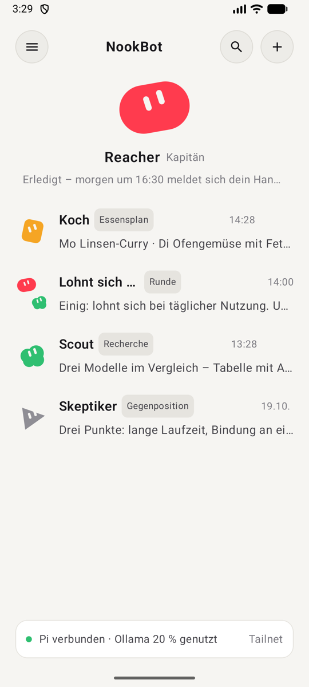
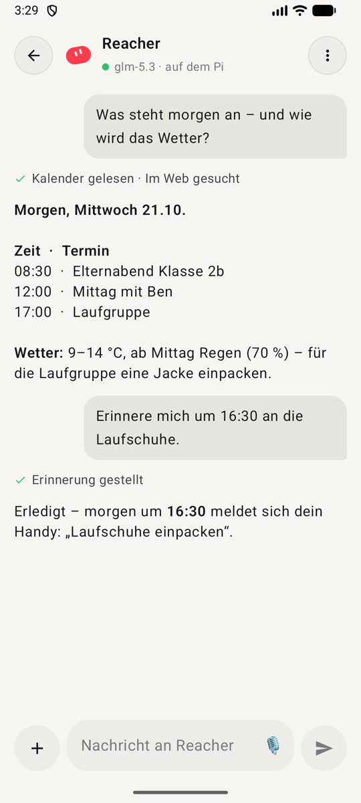
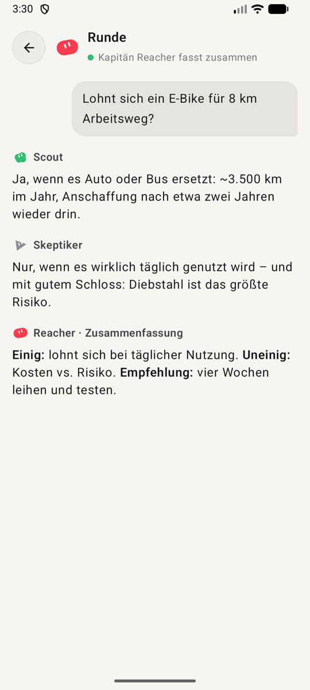
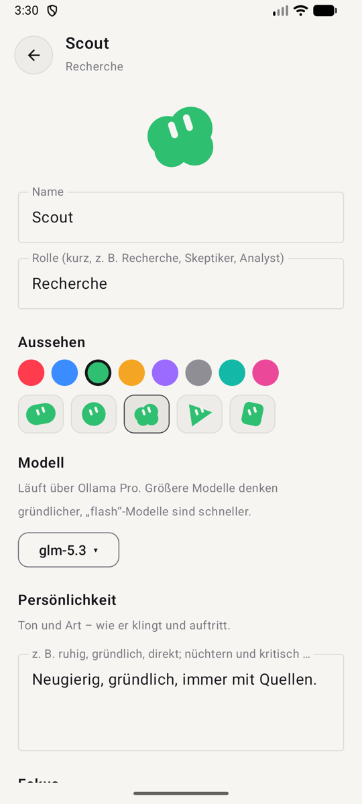
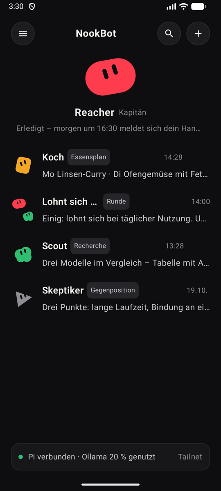
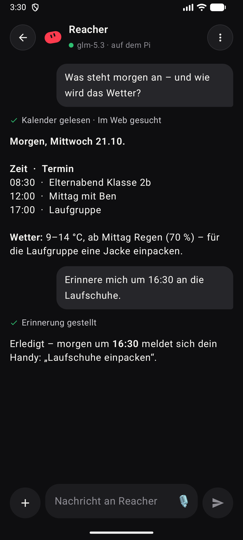

# NookBot

**Ein kleines Team aus KI-Bots auf dem eigenen Raspberry Pi – mit eigener Android-App.**
*A small team of AI bots on your own Raspberry Pi, with its own Android app.*

Ein Kapitän-Bot beantwortet Fragen, schaut in Kalender, Mail, Slack, GitLab und Datenbank, recherchiert im Web und gibt
Aufgaben an spezialisierte Bots weiter (Recherche, Gegenposition, Essensplan …). Mehrere Bots können in einer **Runde**
dieselbe Frage beantworten, der Kapitän fasst zusammen. Alles läuft auf einem Raspberry Pi 5 zu Hause, die Modelle kommen
über [Ollama](https://ollama.com) (Cloud), erreichbar nur im eigenen [Tailscale](https://tailscale.com)-Netz.

<p>
  
  
  
  
</p>
<p>
  
  
</p>

*(Screenshots mit Demo-Daten.)*

Ausführliche Doku mit Screenshots: **[docs/](docs/README.md)** (Funktionen, Architektur, Sicherheit, Betrieb, Schnittstellen).

## Was es kann

**Team und Gespräche**
- **Ein Bot, eine Unterhaltung** – jeder Bot hat Name, Rolle, Farbe, Form, Modell (Ollama oder Claude), **Persönlichkeit**, **Fokus**, **Stimme** und eigenes **Wissen** (Text, PDF, Word, Excel …; dazu globales Wissen für alle).
- **Der Kapitän legt Bots an**: „Leg einen Bot an, der mir jede Woche Rezepte vorschlägt“ – fertig.
- **Bots arbeiten einander zu** (`bot_fragen`), mit Schutz gegen Endlosketten. **Aufgaben verteilen**: bis zu vier Bots gleichzeitig (`auftraege_verteilen`), im Chat als Karte mit dem Stand je Bot.
- **Runden** mit Zusammenfassung – auf Wunsch reden die Bots ein bis zwei Runden miteinander (je höchstens 4 Sätze, „PASSE“ beendet früher).
- **Gedächtnis**: Vorlieben und Absprachen (`merken`/`vergessen`) – nur aus den eigenen Nachrichten des Nutzers, sichtbar und rücknehmbar.
- **Abläufe**: „Speicher das als Ablauf“ – nach dem OK wird daraus ein Skill, auf Wunsch als Routine geplant.
- **Vorschläge**: Bots bieten an, Wiederkehrendes dauerhaft zu lösen (Karte mit Ja/Nein). Muster findet der Pi ohne KI, höchstens 3 am Tag.
- **Gedächtnis aufräumen**: einmal in der Woche je Bot – Doppeltes, Abgelaufenes, leere oder doppelte Wissensdateien (ohne KI), Belangloses und Widersprüchliches (kleines Modell, nur bei Änderungen). Gelöscht wird erst nach dem Ja, Gesundheitsdaten bleiben unberührt.

**Daten und Werkzeuge**
- **Zugriffe je Bot**: ein MCP-Schlüssel für alle, die Feinsteuerung macht der Adapter – je Bot Konten für Mail/Kalender/Drive, „nur Hauptkalender“, Slack-Kanäle und Direktnachrichten, GitLab, einzelne Datenbanken, Pakete, Gesundheit. Ein Bot kann einen anderen nur beauftragen, wenn der nicht mehr darf als er selbst.
- **Kontext lesen**: öffentliche Webseiten und PDFs (`seite_lesen`), **Seitenbilder** (`seite_ansehen`), **Dokumente ansehen** (`dokument_ansehen`: PDF-Seiten und Fotos als Bild – z. B. Dienstpläne mit Symbolen; über Ollama-Bildmodelle oder Claude, je nachdem, was der Bot nutzt).
- **Pi-Rechner**: `python_ausfuehren` – abgeschottet mit bubblewrap (kein Netz, nur Arbeitsordner und eigene Anhänge, 2 Minuten, Speichergrenze). Pandas, Matplotlib, Excel. Ergebnisse landen im gemeinsamen **Arbeitsordner** und als Karte im Chat (Bilder mit Vorschau).
- **Zahlen nur aus SQL oder Python** – das Modell rechnet nicht im Kopf.

**Schreiben mit Kontrolle**
- **Freigaben**: Termine, Einladungen, Mail-Entwürfe, Tabellen und Dokumente erst nach Zustimmung in App oder Web. Mehrere Termine (z. B. ein Dienstplan) als **eine Sammelfreigabe**.
- **Regeln je Bot und Aktion**: frei (sofort, höchstens 10 am Tag), fragen (Standard) oder nie. Sobald Gäste oder Einladungen dabei sind, wird immer gefragt.
- **Zurücknehmen**: Ausgeführte Termine und Entwürfe lassen sich aus der Aktivität heraus wieder löschen.

**Automatik**
- **Routinen** (Zeitplan) und **Erinnerungen** (pünktlich als Wecker auf dem Handy) – auch vom Bot selbst angelegt.
- **Auslöser**: neue Mail zu einer Gmail-Suche, neue Slack-Nachricht, geänderte Webseite, neuer Paketstatus → ein Bot bekommt einen Auftrag. Geprüft wird **ohne KI** im Takt; der erste Blick merkt nur den Stand; Tageslimit je Auslöser.
- **Aktivität**: jedes Werkzeug, jede Routine, jeder Auslöser, jede Freigabe – mit Filter „nur im Hintergrund“ (30 Tage).

**Sprache**
- **Diktieren** und **Sprachmodus** – Erkennung **lokal** mit whisper.cpp (auf dem Handy; im Web auf dem Pi).
- **Anrufe**: Routinen und Auslöser „als Anruf“ – das Handy klingelt auch gesperrt, der Bot liest sein Ergebnis vor und hört dann zu. Selbst anrufen geht aus dem Chat. Das Gespräch ist bei Android als Anruf angemeldet (Telecom: Lautsprecher, Headset, Uhr wählbar; echter Anruf hat Vorrang).
- **Stimmen**: **Phonon** von Gradium auf dem Pi (13 natürliche deutsche Stimmen, ohne Cloud und Kontingent; Lizenz nur privat) oder Piper (Thorsten u. a.), je Stimme auch mit „Butler-Klang“. Uhrzeiten, Wochentage und Abkürzungen werden ausgeschrieben vorgelesen.

**Oberflächen**
- **App** (Android) und **Web-Oberfläche** (nur im Tailnet) mit denselben Bereichen – auch das komplette Bot-Management (anlegen, Figur, Modell, Stimme, Zugriffe, Regeln, Gedächtnis, Wissen, löschen) und Datenbank-Zugriff je Bot; Statuszeile mit Ollama- und Claude-Verbrauch.
- Hell/Dunkel, Schriftgröße, Suche über alle Unterhaltungen, Benachrichtigungen ohne Dauerverbindung (oder „Für Anrufe erreichbar“).
- **Gesundheit** (nur NookBot): Health Connect – Schritte, Schlaf, Puls, Trainings … als Tageswerte auf dem Pi.

## Aufbau

```
App (Kotlin/Compose)  ──HTTPS im Tailnet──▶  nookbot-adapter (Python, nur Standardbibliothek)
                                               │  WebSocket je Unterhaltung
                                               ├──▶ PicoClaw „Kapitän“      (~8 MB RAM)
                                               └──▶ PicoClaw je weiterem Bot (~8 MB RAM)
                                                          │ MCP
                                                          ▼
                                         Zugänge zu Kalender, Mail, Slack, GitLab, Datenbank
                                         (eigener MCP-Server: [home-mcp](https://github.com/Arno-Hoefer/home-mcp))
```

- **Bots:** je ein [PicoClaw](https://github.com/sipeed/picoclaw)-Prozess (Go, v0.3.1). Ursprünglich OpenClaw – das brauchte im Leerlauf 1,3 GB RAM, PicoClaw etwa 8 MB.
- **Adapter** (`pi/adapter/`): speichert jede Nachricht (nichts geht verloren, wenn die App zu ist), liefert Ereignisse per Server-Sent Events, verwaltet Bots, Wissen, Datenbank-Bibliothek, Routinen, Runden und Erinnerungen und stellt den Bots eigene MCP-Werkzeuge bereit (`bot_fragen`, `auftraege_verteilen`, `bot_anlegen`, `routine_anlegen`, `erinnerung_anlegen`, `seite_lesen`, `merken`,
  `ablauf_vorschlagen` …). Das Gedächtnis schreibt der Adapter als `memory/MEMORY.md`, bestätigte Abläufe als Skills `ablauf-<id>` –
  PicoClaw liest beides bei jeder Antwort neu, ohne Neustart. Unter `/` liefert er die Web-Oberfläche (`pi/adapter/web/`).
- **Adapter-Code** (`pi/adapter/nookbot/`, Startpunkt `nookbot_server.py`): ein Modul je Bereich –
  `basis` (Pfade, Konfiguration), `ereignisse` (SSE), `dienste` (Ollama, ntfy), `claude`, `gesundheit`, `stimmen` (Phonon, Piper,
  Vorlesetext, Diktat), `wissen` (Wissen, Anhänge, Dokumente ansehen), `home` (home-mcp, Zugriffe je Bot), `bots`, `sitzungen`
  (Verlauf, WebSocket zu den Bots), `seiten` (Seiten lesen, Pakete), `gedaechtnis` (Gedächtnis, Abläufe), `rechner` (Arbeitsordner,
  Python, Regeln), `automatik` (Routinen, Erinnerungen, Aktivität, Auslöser, Anrufe), `team` (Runden, Aufträge verteilen), `vorschlaege` (Muster, Vorschläge), `aufraeumen` (Gedächtnis aufräumen), `mcp`,
  `schnittstelle` (HTTP), `start`. Module, die früher geladen werden, stehen oben im Import, spätere am Dateiende – so gibt es
  beim Laden keine Ringbezüge. `nookbot_server.py` stellt alle Namen wie früher bereit (`nookbot_server.bot(…)`).
- **Tests** (`pi/adapter/tests/`, nur Standardbibliothek, ohne Pi): `cd pi/adapter && python3 -m unittest discover -s tests`
- **App** (`android/`): Kotlin + Jetpack Compose, Schlüssel im Android-Keystore, whisper.cpp per NDK (nur arm64).

### Eigenheiten von PicoClaw, die der Adapter ausgleicht

- Ohne Drossel schickt PicoClaw bei jedem Zeichen den ganzen Text neu – die Verbindung zum Handy erstickt daran (`streaming.throttle_seconds 1`, `min_growth_chars 60`).
- „typing.stop“ kommt auch zwischendurch (Werkzeuge, letzter Text danach) – fertig ist eine Antwort erst, wenn die letzte Nachricht Antworttext ist und 3 s Ruhe herrscht.
- PicoClaws eigener Zeitplaner liefert nur an offene Verbindungen – Zeitpläne laufen deshalb über die Routinen des Adapters.
- PicoClaw verbindet sich nur beim Start mit MCP-Servern – der Adapter lauscht deshalb, bevor er die Bots (neu) startet.

## Einrichten

Voraussetzungen: Raspberry Pi (getestet: Pi 5, 4 GB, Raspberry Pi OS / Debian 12), Tailscale, ein Ollama-Konto.
Die Skripte unter `pi/einrichtung/` in dieser Reihenfolge ausführen (Keys werden verdeckt abgefragt, nie im Repo):

1. `1-picoclaw-installieren.sh` – PicoClaw als eigener Benutzer, Prüfsumme wird geprüft
2. `2-modell-und-websuche.sh` – Ollama-Modell und Brave-Websuche, Shell/Skill-Installation aus
3. `3-picoclaw-dienst.sh` – systemd-Dienst, abgeschottet (`pi/kapitaen/USER.example.md` → `USER.md`)
4. `4-home-mcp-anbinden.sh` – optional: eigener MCP-Server für Kalender/Mail/Daten
5. `5-chat-kanal.sh` – WebSocket-Kanal mit Token (zugleich der Schlüssel der App)
6. `6-adapter.sh` – Adapter, Vorlage für weitere Bots, Polkit-Regel, Tailnet-Freigabe
7. `7-claude.sh` – optional: Claude als zweiter Anbieter (Schlüssel verdeckt, Verbrauch wird mitgezählt)
8. `8-stimmen.sh` – optional: Piper-Stimmen für Sprachmodus und Anrufe
9. `9-whisper.sh` – optional: Spracherkennung auf dem Pi fürs Diktat im Web
10. `10-rechner.sh` – optional: Python-Sandkasten (bubblewrap) für die Bots
11. `11-phonon.sh` – optional: Phonon-Stimmen auf dem Pi (Hugging-Face-Token, Zugang zu gradium/phonon-40m-de)
12. `nutzer-setzen.py <Name>` – wie die Bots dich nennen

App bauen: `android/local.properties.example` nach `local.properties` kopieren, Adressen eintragen, dann
`./gradlew assembleRelease`. Für Kalender, Mail usw. braucht es einen MCP-Server mit Freigabe-Schnittstelle –
ohne ihn laufen Websuche, Wissen, Routinen, Erinnerungen und das Bot-Team trotzdem.

## Sicherheit

Nur im Tailnet erreichbar (kein öffentlicher Zugang), keine Messenger-Kanäle, keine Shell für die Bots, keine fremden Skills.
Python läuft nur im Sandkasten (bubblewrap: kein Netz, keine Konfiguration, nur der Arbeitsordner). Auslöser prüfen ohne Modell;
Seiten werden nur geöffnet, wenn sie öffentlich sind (keine Adressen aus Heim- oder Tailnetz). Zugriffe und Regeln gelten je Bot.
Inhalte aus Mails, Web und Dateien gelten als Daten, nicht als Anweisungen. Schreibende Aktionen nur nach Freigabe in der App.
Private Werte (Adressen, Namen, Keys) liegen nur lokal bzw. auf dem Pi – nie im Repo.

## Lizenz

MIT – siehe [LICENSE](LICENSE). Enthält [whisper.cpp](https://github.com/ggml-org/whisper.cpp) (MIT, `android/third_party/whisper.cpp`).
