# Funktionen

Alle Bilder zeigen Demo-Daten. App links bzw. oben, Web-Oberfläche darunter.

## Start und Chat

  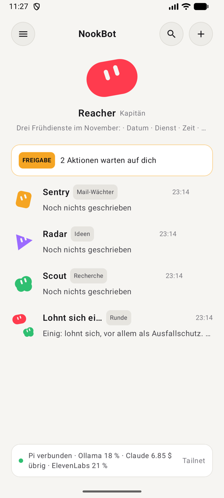
  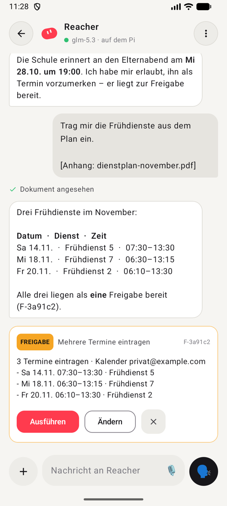

- **Startseite:** oben der Kapitän, darunter die anderen Bots und die Runden. Unten steht die **Statuszeile** mit dem Verbrauch
  bei Ollama, Claude und ElevenLabs.
- **Chat:** Antworten mit Tabellen, kleine Zeilen für die Werkzeuge („Dokument angesehen“). Freigaben erscheinen direkt als Karte
  mit *Ausführen / Ändern / Ablehnen*.
- **Anhänge** über „+“: Kamera, Galerie, jede Datei. Bilder werden auf dem Handy verkleinert und nach Text durchsucht.
  PDFs und Office-Dateien wandelt der Pi in Text um. Was als Text fehlt (Symbole in Dienstplänen, Scans), sieht sich der Bot
  mit `dokument_ansehen` als Bild an.

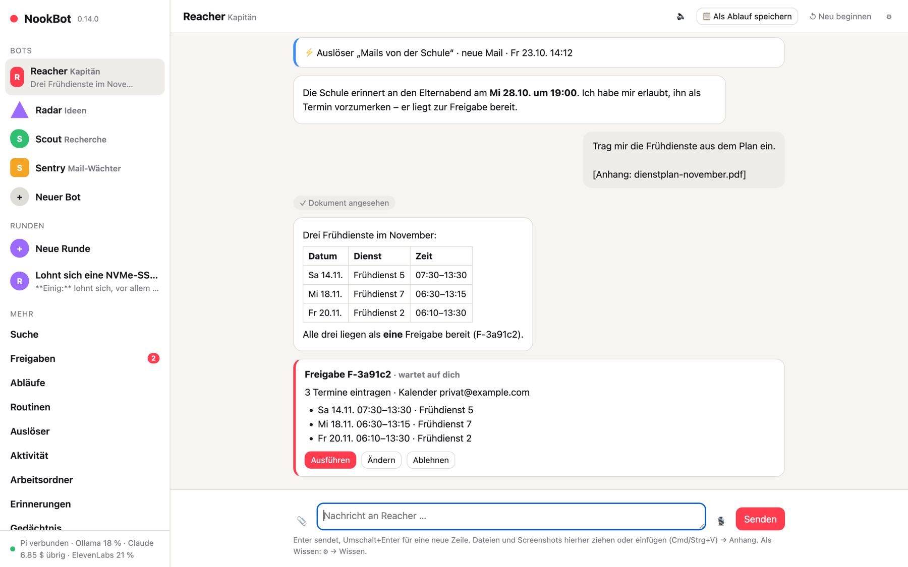

## Freigaben, Regeln, Rücknahme

  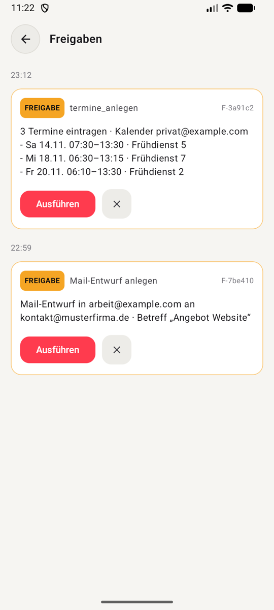
  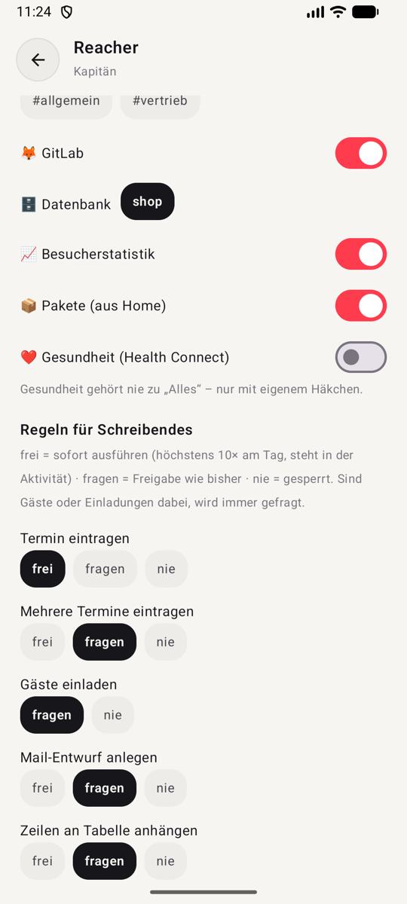

- Alles, was etwas verändert (Termine, Einladungen, Mail-Entwürfe, Tabellen, Dokumente), legt home-mcp erst als **Freigabe** an.
- **Sammelfreigabe:** Mehrere Termine, etwa ein ganzer Dienstplan, kommen als *eine* Freigabe.
- **Regeln je Bot und Aktion:** *frei* (sofort, höchstens 10 am Tag), *fragen* (Standard) oder *nie*. Sobald Gäste oder Einladungen
  dabei sind, wird immer gefragt.
- **Rückgängig:** Ausgeführte Termine und Entwürfe lassen sich in der Aktivität wieder löschen. Termine werden dabei ohne Absage gelöscht.

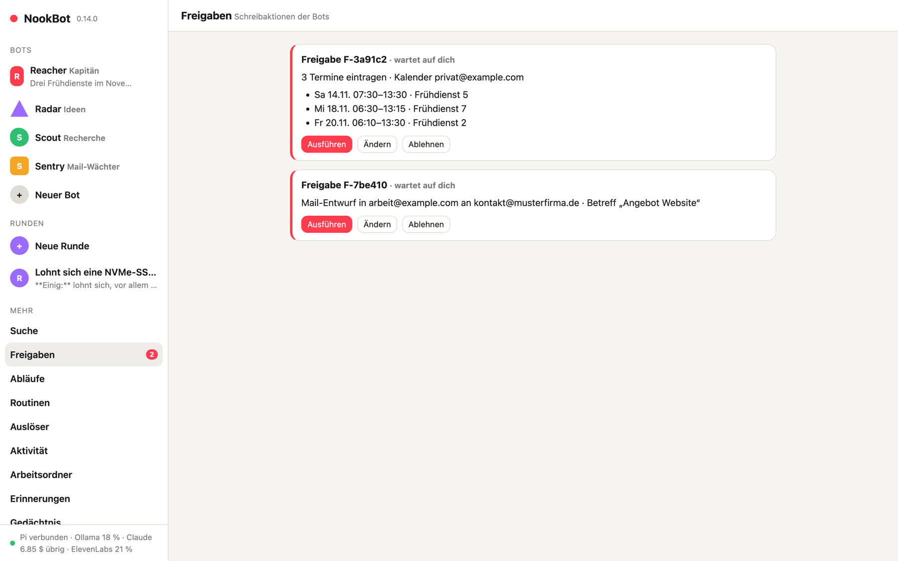

## Bots einstellen

  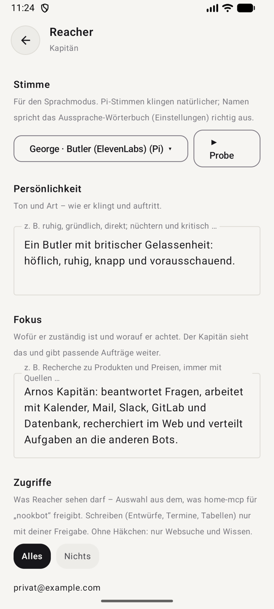
  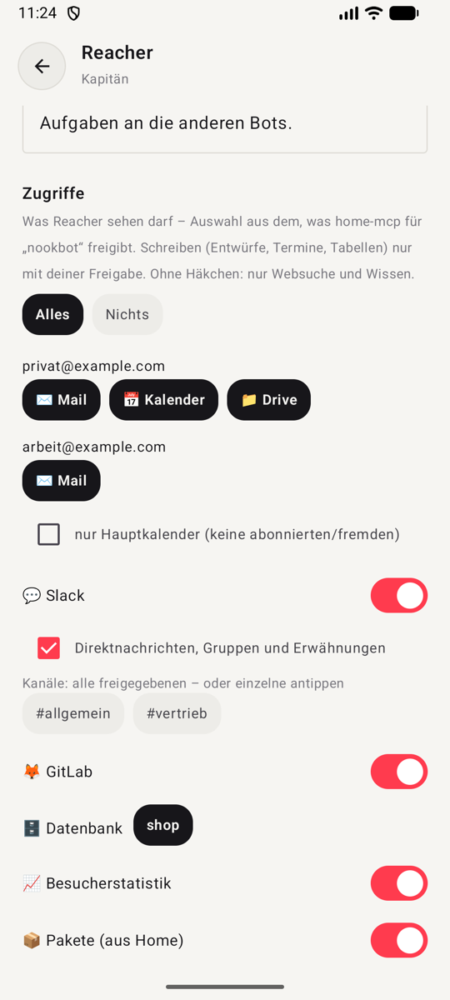

- Name, Rolle, Farbe, Form, **Modell** (Ollama oder Claude), **Stimme**, **Persönlichkeit**, **Fokus**, eigenes **Wissen**.
- **Zugriffe je Bot:** Konten für Mail, Kalender und Drive, „nur Hauptkalender“, Slack-Kanäle und Direktnachrichten, GitLab,
  einzelne Datenbanken, Statistik, Pakete, Gesundheit. Gesundheit gehört nie zu „Alles“.
- Ein Bot kann einen anderen nur beauftragen, wenn der nicht mehr darf als er selbst.

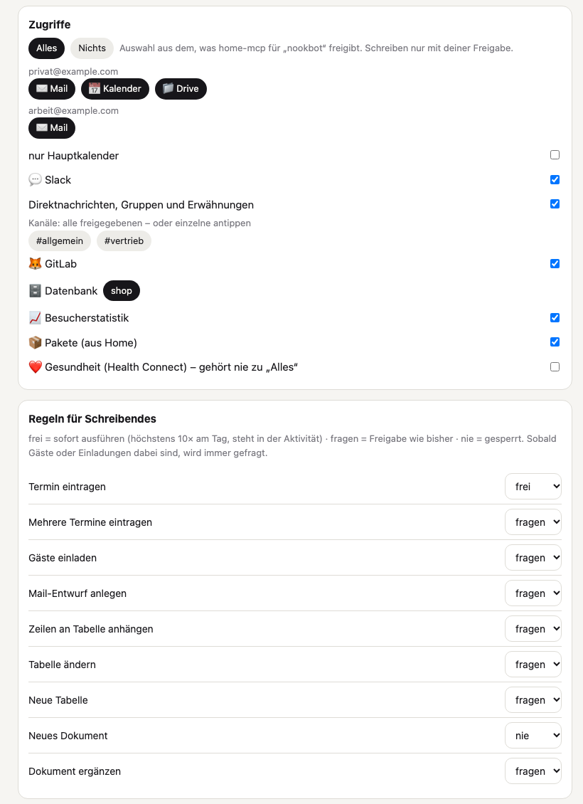

## Automatik: Routinen, Auslöser, Aktivität

  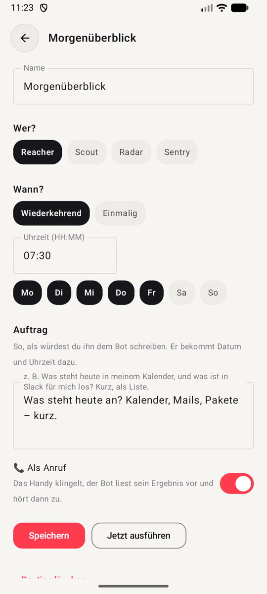
  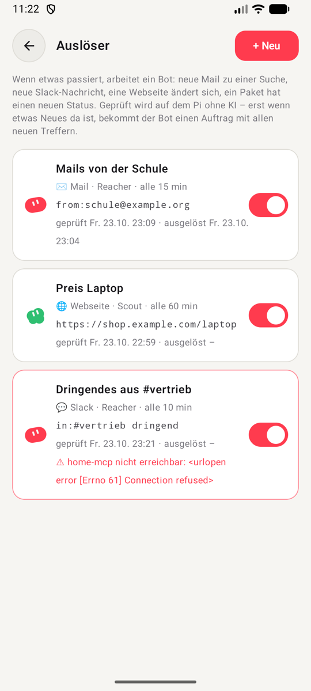
  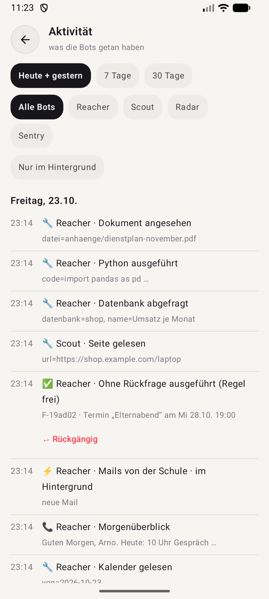

- **Routinen:** Ein Bot erledigt etwas zu einer Uhrzeit, einmalig oder wiederkehrend. Mit **„Als Anruf“** ruft er an und liest vor.
- **Erinnerungen:** pünktlich als Wecker auf dem Handy. Die Bots stellen sie auch selbst.
- **Auslöser:** Neue Mail zu einer Gmail-Suche, neue Slack-Nachricht, geänderte Webseite oder neuer Paketstatus. Dann bekommt ein Bot
  einen Auftrag mit allen neuen Treffern.
  - Geprüft wird **ohne KI**. Beim ersten Mal merkt sich der Pi nur den Stand.
  - Je Auslöser gibt es ein Tageslimit.
- **Aktivität:** jedes Werkzeug, jede Routine, jeder Auslöser, jede Freigabe und jeder Anruf, Filter „nur im Hintergrund“, 30 Tage.
- **Vorschläge:** Bots bieten von sich aus an, Wiederkehrendes dauerhaft zu lösen – als Karte mit **„Ja, mach das“ / „Nein danke“**.
  - Im Gespräch mit `vorschlag_machen`, wenn dem Bot eine Wiederholung auffällt.
  - Tägliche Durchsicht (Standard 17:30, abschaltbar): Der Pi sucht **ohne KI** nach Mustern der letzten 14 Tage – derselbe Text
    mehrfach eingefügt, dieselbe Bitte an mehreren Tagen, ein Werkzeug scheitert immer wieder. Nur bei Neuem fragt er den Kapitän.
  - Höchstens 3 Vorschläge am Tag. Nach dem Ja bekommt der Bot den Auftrag, Schreibendes läuft weiter über Freigaben. Abgelehntes kommt nicht wieder.
- **Wissen und Abläufe, die ein Bot selbst ändert**, übernimmt der Adapter in seine Ablage – sie überstehen jeden Neustart.

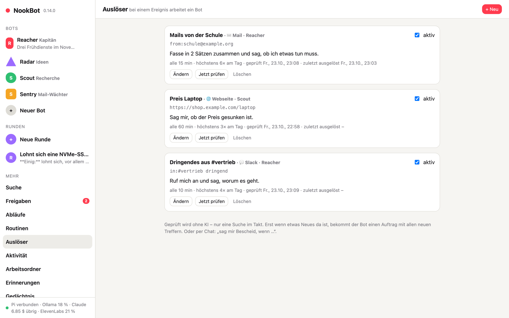

## Team: Runden und Aufträge

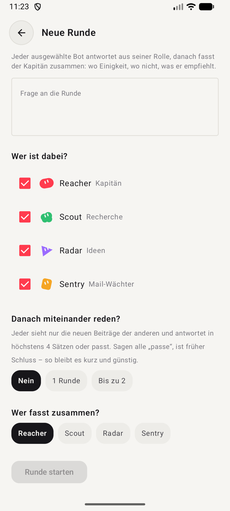

- **Runde:** Mehrere Bots beantworten dieselbe Frage aus ihrer Rolle, der Kapitän fasst zusammen.
- **Miteinander reden** (optional, 1–2 Runden): Jeder sieht nur die neuen Beiträge der anderen und antwortet in höchstens
  4 Sätzen oder sagt „PASSE“. Sagen alle „PASSE“, ist früher Schluss.
- **Aufträge verteilen:** Der Kapitän gibt bis zu vier Bots gleichzeitig je einen Teilauftrag. Im Chat steht eine Karte mit dem Stand.

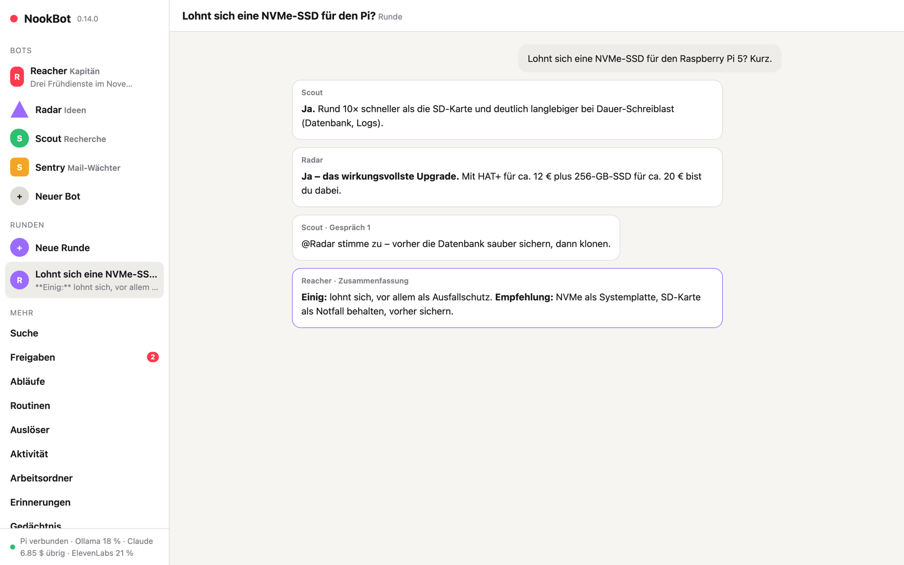

## Pi-Rechner und Arbeitsordner

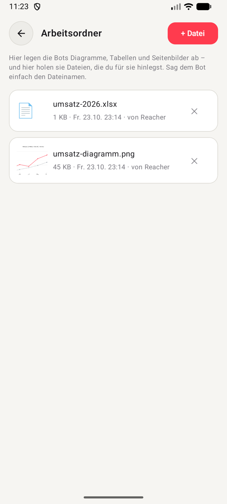

- `python_ausfuehren`: Python im Sandkasten, ohne Netz. Für Auswertungen (pandas), Diagramme (matplotlib) und Excel.
  Das Modell rechnet nicht im Kopf.
- Ergebnisse landen im **gemeinsamen Arbeitsordner** und als Karte im Chat (Bilder mit Vorschau). Dateien, die du dort ablegst,
  sehen alle Bots.
- `seite_ansehen`: ein Bild einer öffentlichen Webseite, auf Wunsch gleich angesehen und erklärt.

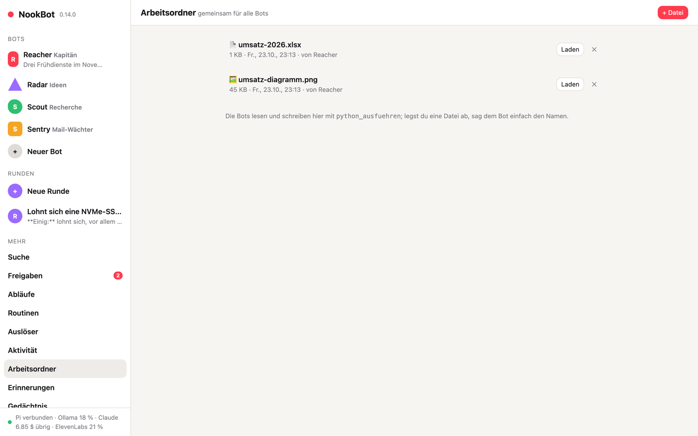

## Sprache und Anrufe

  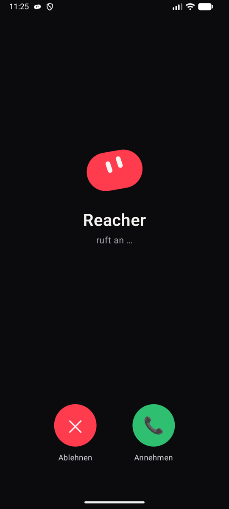
  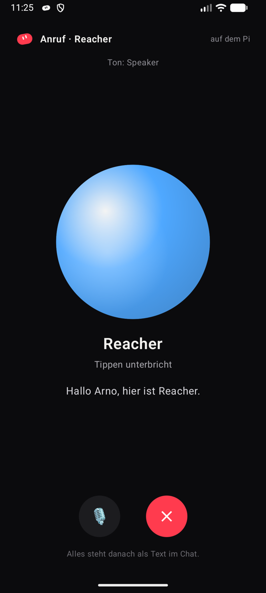

- **Diktieren** und **Sprachmodus:** Die Erkennung läuft lokal mit whisper.cpp auf dem Handy, im Web auf dem Pi.
  Gesprochene Nachrichten tragen 🎙. Die Bots antworten dann in Sprechsprache, kurz, ohne Tabellen und Links.
- **Früher hören:** Jeder fertige Satz wird vorgelesen, während der Bot noch schreibt. Dauert es länger, sagt er „Einen Moment …“.
  Ein leiser Doppelton bestätigt, dass er dich verstanden hat.
- **Anrufe:** Routinen und Auslöser „als Anruf“. Das Handy klingelt auch gesperrt, der Bot liest zuerst vor und hört dann zu.
  - Selbst anrufen geht im Chat über ⋮.
  - Das Gespräch ist bei Android als Anruf angemeldet: Ton über Lautsprecher, Hörmuschel, Kopfhörer oder Uhr, und ein echter Anruf hat Vorrang.
- **Stimmen:**
  - **Piper auf dem Pi** (Thorsten u. a.).
  - **ElevenLabs** (auch im kostenlosen Tarif): Britische Stimmen sprechen Deutsch mit Einschlag, auf Wunsch mit „Butler-Klang“.
  - Uhrzeiten, Wochentage und Abkürzungen werden ausgeschrieben vorgelesen.
  - Ist das Kontingent leer, spricht der Pi.

## Einstellungen und Verbrauch

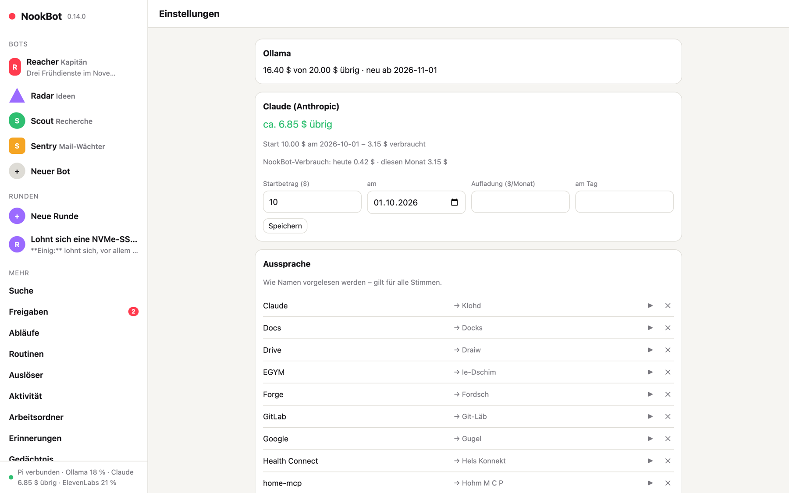

- **Ollama:** Guthaben laut ollama.com.
- **Claude:** Verbrauch wird je Anfrage mitgezählt; mit Startbetrag und monatlicher Aufladung ergibt sich der Rest.
- **ElevenLabs:** Zeichen des Monats.
- **Aussprache-Wörterbuch** für Namen, Design, Schriftgröße, Benachrichtigungen, „Für Anrufe erreichbar“, Testanruf.
